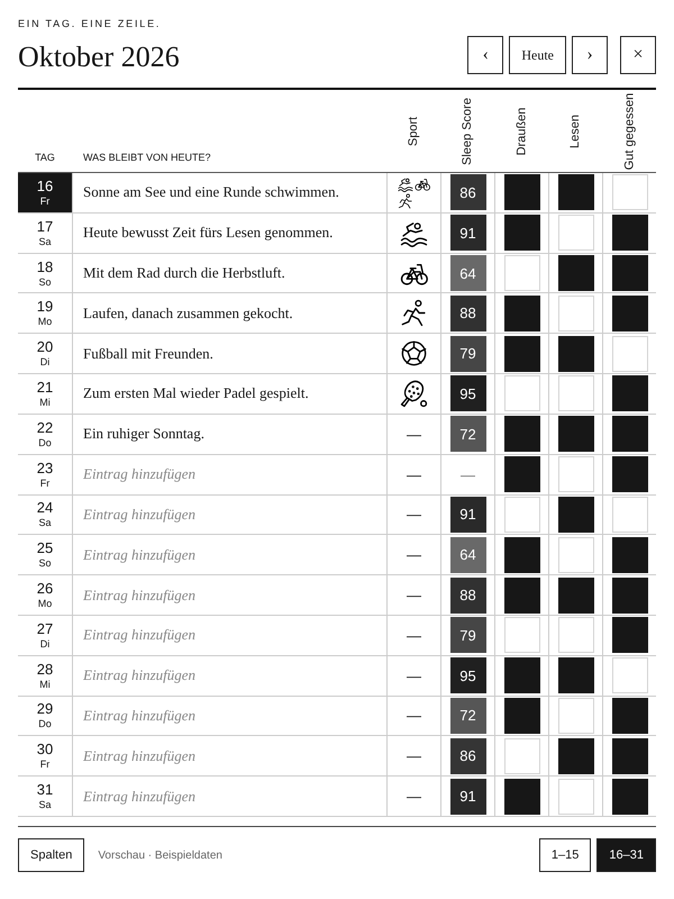
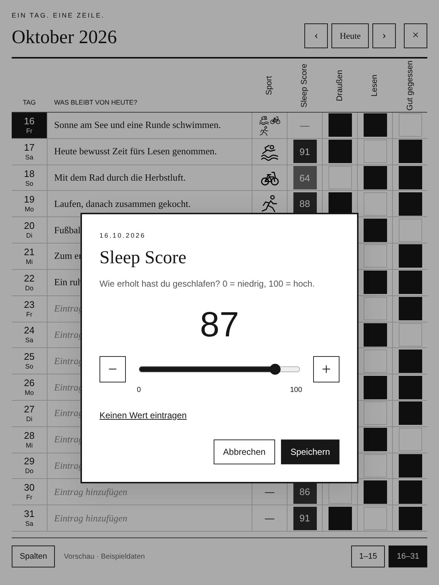

# HTML-Entwurf für die nächste Kindle-Ansicht

Die Bilder stammen aus der tatsächlichen HTML-Vorschau, mit einem 600 × 800 Pixel großen Tagebuchbereich und zweifacher Bildauflösung. Alle Inhalte sind Beispieldaten. Es handelt sich um einen Browser-Entwurf, keinen Screenshot vom Kindle. Die KOReader-ZIP enthält weiterhin die zuletzt veröffentlichte native Ansicht; diese Vorschau muss nach der Designabstimmung noch übertragen werden.





## Ausprobieren

Im Hauptverzeichnis:

```sh
python3 -m http.server 8770 --bind 127.0.0.1
```

Dann `docs/design-preview.html` über den lokalen Server öffnen. Alternativ die HTML-Datei zusammen mit `koreader/ebookdiary.koplugin/icons/` herunterladen und lokal im Browser öffnen. Der Entwurf verwendet keine externen Fonts oder Bibliotheken. Der Menüpunkt „Heute“ springt absichtlich zum Beispieldatum 16. Oktober 2026. Monatsnavigation, Monatshälften, Textbearbeitung, Sportauswahl, Tracker, ein-/ausblendbare Spalten und ein zusätzlicher eigener Tracker sind zum Testen bedienbar. Änderungen werden nur im Arbeitsspeicher gehalten und beim Neuladen verworfen; es gibt weder Speicherung persönlicher Daten noch Synchronisation.

Die Beschriftungen sind um 90 Grad gedreht und die Datumsspalte ist breiter. Zweistellige Tage und die Standardtitel werden vollständig dargestellt. Die Kacheln sind 32 × 32 Pixel groß. Bis zu 16 Tageszeilen bleiben im Bereich sichtbar. Der Sleep-Score-Dialog bietet einen Slider in Einerschritten, −/+-Tasten und „Keinen Wert eintragen“. Fehlende Daten und ein Score von 0 bleiben getrennte Zustände; Speichern übernimmt, Abbrechen verwirft die Änderung.

## Browserprüfung

Mit Node, Playwright und Chromium, während der obige Server läuft:

```sh
node tools/check_design_preview.cjs
```

Optional `CHROMIUM_PATH` für den Browserpfad und `DIARY_PREVIEW_URL` für eine abweichende lokale URL setzen. Der Test prüft Navigation und Seitenwechsel, 15/16 Tage, vollständig sichtbare zweistellige Tageszahlen und Standardbeschriftungen, quadratische Kacheln, geladene Sport-Symbole, Slidergrenzen 0/100, Entfernen und Abbrechen, ±1-Tasten, eine zusätzliche Spalte, die Gesamtbreite bei 600 Pixeln und JavaScript-Laufzeitfehler. Er erzeugt die beiden Bilder erneut. Darstellung, Textgrößen und Gesten auf dem echten Kindle sind dadurch nicht geprüft.

Die anschließende Synchronisation ist noch offen: Der vorhandene Browser-Prototyp beschreibt bereits den vorgeschlagenen lesenden Umbrel-Tagesdaten-Endpunkt; dessen Implementierung im Dashboard und der Abgleich im KOReader-Plugin sind separate nächste Entwicklungsschritte.
